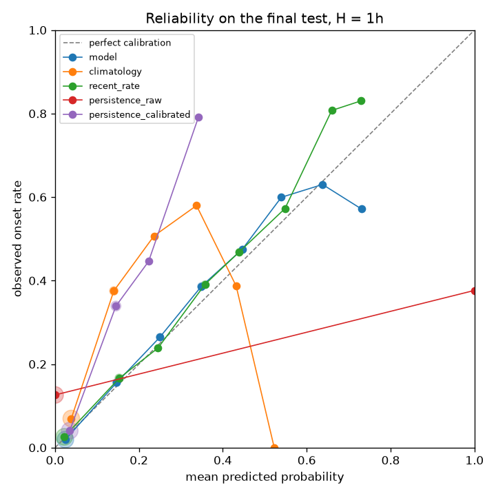
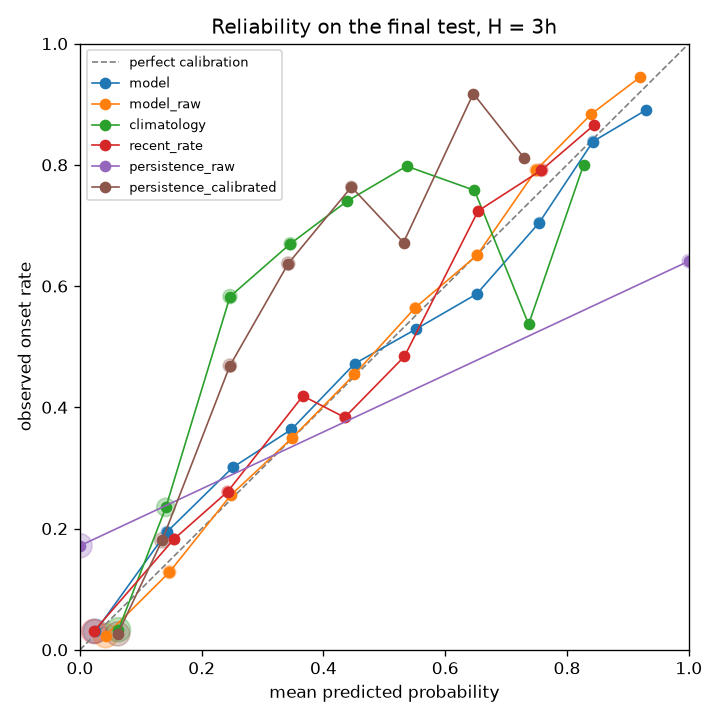

# Air-raid alert onset forecasting — Ukraine

> For each oblast and each hour: the probability that a NEW air-raid alert starts within the next hour, using only
> what is known at that moment. Tested once on the last 6 weeks of official data against simple baselines, with tests
> that check no future information is used.

<!-- GENERATED:headline START -->
Final test, H = 1 (scored once): Brier skill of the model vs the rolling recent-rate baseline = **-0.0101** on 13,116 rows (base rate 0.1390): the model does NOT beat the rolling recent-rate baseline.
<!-- GENERATED:headline END -->

**Status (13 Oct 2026):** M1–M5 implemented (see `DECISIONS.md`, `plans/`, `reviews/`). Results site: `site/index.html`
(self-contained; Netlify-ready, see "How to run"). Open decision for the human: which API alert types the exploratory
section counts (see "New alert system").

## Problem framing
- **Why "a new alert starts" and not "an alert is active":** being under alert at t almost guarantees being under alert
  at t+1h, so "active" targets reward persistence and give inflated scores. We predict onsets only. Hours already under
  alert are excluded from training and testing.
- **Why oblast level:** that's how people experience alerts and how the groups compare (Kyiv City / frontline / rear).
  Since the 2025 admin reform alerts are issued per raion or hromada, so an oblast counts as under alert if any
  non-standing alert anywhere in it is active.
- **Why probabilities:** a forecast is only useful if a stated chance matches how often the event then happens.
  Calibration is measured (Brier score, reliability plots), not assumed.

## Data
- **Main source:** Vadimkin/ukrainian-air-raid-sirens-dataset, `official_data_en.csv`, downloaded at run time. The
  official export stopped on 7 Sep 2026 (the yellow/red reform).
- **Issues found and how they are handled** (evidence in `DECISIONS.md`):
  - **Duplicates:** exact duplicate rows are removed first, on the raw strings, with hard checks on the counts (D-022).
  - **2025 admin reform:** oblast-level rows alone make the target collapse (the v1 bug); all levels are merged per
    oblast (D-002).
  - **Standing alerts:** some hromada alerts last for months. An alert counts as "under alert" only for its first 24
    hours, which is known at t without its end time; its start still counts as an onset (D-020).
  - **Recording gap, end of August 2026:** treated as missing, not as calm. The label/state mask covers one hour (or H
    hours) before the approved gap, the gap, and 24 hours after it; features whose look-back window touches the
    uncertainty zone are missing, and missing-feature rows are not scored (D-022–D-024).
  - **Excluded units:** Luhanska (permanent alert since 2022); Crimea is not in the data (D-008).
  - **Exactly-30-minute alerts:** kept and counted (D-010).

<!-- GENERATED:data_facts START -->
| Fact (official file) | Value |
|---|---|
| Raw rows | 299,275 |
| Exact duplicate rows removed | 113,845 |
| Rows after deduplication | 185,430 |
| Luhanska rows excluded | 1 |
| Detected recording gap (UTC) | 2026-08-29 05:00 → 2026-09-02 13:00 |
| Approved gap (UTC) | 2026-08-29 00:00 → 2026-09-03 00:00 |
| Alerts lasting > 24h (before the test) | 757 |
| Exactly-30-minute alerts (before the test) | 38 |
| Zero-duration alerts | 2 |
<!-- GENERATED:data_facts END -->

- **New system since September 2026:** yellow = drones, red = missiles. One month of alerts.in.ua history is used only
  for the exploratory section and is never mixed with the official data (D-007, D-015). Alerts still open when the API
  was read are kept with the 24-hour rule (D-027).

## Method
- **Grid and target:** an hourly UTC grid for the 24 units. y(t) = 1 if a merged-unit onset (D-023) falls in
  (t, t+H]: an onset exactly at t is not in y(t), one exactly at t+H is. Hours under alert at t are masked.
- **Features**, all computed from data with timestamp ≤ t: time since the last onset and the last end; onsets in the
  last 24 hours and 7 days; neighbouring oblasts under alert (fixed border table); national count under alert; hour
  and weekday in Kyiv time; unit code.
- **Baselines:** hour × weekday climatology from train; the **rolling 14-day recent rate** (labels already known at t:
  rows in [t − 14d, t − H], shrunk toward the unit's train rate, D-025) — the main bar to beat; raw persistence;
  calibrated persistence (unit × time since the last alert ended).
- **Model:** one pooled LightGBM model per horizon, fixed settings (no search), early-stopped on validation, no refit.
  A pre-registered rule applies Platt scaling (fitted on validation only) when validation calibration error exceeds
  the threshold (M4 plan §3).
- **Splits (half-open, UTC):** train from 23 Mar 2022 to 29 Jun 2026; validation 29 Jun – 27 Jul 2026; **final test
  27 Jul – 7 Sep 2026, scored once** for the model and all baselines together. A training row is kept only if
  t + H ≤ the cut-off.
- **Scored once, for real:** before the test, both horizons' model, calibrator, baseline tables, validation
  predictions, data file and code were hashed into `reports/<run>/preregistration.json`. One joint marker
  (`reports/final_test_access.json`) is written before any test label is read; a changed predictor after that is
  refused, and so is refitting.
- **Metrics:** primary = Brier skill against the rolling recent rate. Secondary: Brier, ROC-AUC pooled AND mean
  within-unit, PR-AUC and PR-AUC divided by the base rate, the overall reliability plot, calibration-in-the-large.
  Reported overall and for Kyiv City / frontline (8 oblasts) / rear (15 oblasts).

## No-leakage evidence
Tests that ran on this build (they cover the listed cases; they are not a proof for every hour):

<!-- GENERATED:leakage START -->
| Check | Result | Evidence (pytest node) |
|---|---|---|
| Features unchanged when data after t is removed (real data, 33 times: active and standing alerts, gap edges, DST, cut-offs, off-hour times) | PASS | `tests/test_leakage.py::test_real_data_truncation_invariant` |
| Negative control caught: a feature using the final alert duration / a centred window | PASS | `tests/test_leakage.py::test_real_data_negative_control_pinned_witnesses` |
| Grid mask unchanged by truncation; the old D-009 rule (final duration) is caught | PASS | `tests/test_grid.py::test_mask_truncation_invariant` |
| Recent rate and raw persistence unchanged by truncation, H = 1 and H = 3 | PASS | `tests/test_leakage.py::test_baselines_truncation_invariant` |
| Negative control caught: a recent-rate window that reads not-yet-known labels | PASS | `tests/test_leakage.py::test_baselines_negative_control` |
| Model predictions unchanged by truncation | PASS | `tests/test_leakage.py::test_model_predictions_truncation_invariant` |
| API loader -> grid -> features -> prediction unchanged by truncating the raw dump | PASS | `tests/test_leakage.py::test_api_loader_to_predictor_truncation_invariant` |
| Negative control caught on API data: final alert duration | PASS | `tests/test_leakage.py::test_api_negative_control_final_duration` |
| Frozen baselines fit on train only; validation labels cannot change them | PASS | `tests/test_run_all.py::test_frozen_baselines_fit_on_train_only` |
| Test labels cannot change any pre-test output (H = 3 label poisoning) | PASS | `tests/test_run_all.py::test_h3_label_poisoning_changes_nothing` |
| Final test: joint access marker written before any test label is read | PASS | `tests/test_final_test.py::test_marker_written_before_any_test_label` |
| Final test: a changed predictor after access is refused | PASS | `tests/test_final_test.py::test_new_preregistration_after_access_is_refused` |
<!-- GENERATED:leakage END -->

## Results
The final test was scored once. Every number below is generated from `reports/` by `scripts/build_site.py`.

<!-- GENERATED:final_h1 START -->
**Final test, H = 1 hour (headline)**

| Predictor | Group | Brier | Brier skill vs recent rate | ROC-AUC pooled | ROC-AUC within unit | PR-AUC | PR-AUC / base rate | Rows | Base rate | Low-n |
|---|---|---|---|---|---|---|---|---|---|---|
| Model (LightGBM) | All units | 0.0890 | -0.0101 | 0.8754 | 0.6320 | 0.4764 | 3.4278 | 13,116 | 0.1390 | yes |
| Model (LightGBM) | Kyiv City | 0.0994 | 0.0738 | 0.7092 | 0.7092 | 0.3421 | 2.7878 | 709 | 0.1227 | no |
| Model (LightGBM) | Frontline (8) | 0.2473 | -0.0753 | 0.6097 | 0.6041 | 0.5763 | 1.2037 | 1,648 | 0.4788 | yes |
| Model (LightGBM) | Rear (15) | 0.0641 | 0.0161 | 0.8782 | 0.6421 | 0.3669 | 4.1680 | 10,759 | 0.0880 | yes |
| Recent rate (14 d) | All units | 0.0881 | 0.0000 | 0.8701 | 0.4912 | 0.5117 | 3.6814 | 13,116 | 0.1390 | yes |
| Recent rate (14 d) | Kyiv City | 0.1074 | 0.0000 | 0.5519 | 0.5519 | 0.2328 | 1.8971 | 709 | 0.1227 | no |
| Recent rate (14 d) | Frontline (8) | 0.2300 | 0.0000 | 0.6571 | 0.4585 | 0.6529 | 1.3637 | 1,648 | 0.4788 | yes |
| Recent rate (14 d) | Rear (15) | 0.0651 | 0.0000 | 0.8631 | 0.5062 | 0.3482 | 3.9560 | 10,759 | 0.0880 | yes |
| Climatology | All units | 0.1112 | -0.2618 | 0.8395 | 0.5407 | 0.4046 | 2.9112 | 13,116 | 0.1390 | yes |
| Climatology | Kyiv City | 0.1112 | -0.0357 | 0.6024 | 0.6024 | 0.1659 | 1.3516 | 709 | 0.1227 | no |
| Climatology | Frontline (8) | 0.3504 | -0.5235 | 0.5705 | 0.5452 | 0.5256 | 1.0979 | 1,648 | 0.4788 | yes |
| Climatology | Rear (15) | 0.0746 | -0.1447 | 0.8319 | 0.5309 | 0.2812 | 3.1947 | 10,759 | 0.0880 | yes |
| Calibrated persistence | All units | 0.1041 | -0.1810 | 0.8704 | 0.6050 | 0.4926 | 3.5438 | 13,116 | 0.1390 | yes |
| Calibrated persistence | Kyiv City | 0.1083 | -0.0092 | 0.6736 | 0.6736 | 0.2241 | 1.8265 | 709 | 0.1227 | no |
| Calibrated persistence | Frontline (8) | 0.3111 | -0.3526 | 0.6414 | 0.5943 | 0.6301 | 1.3161 | 1,648 | 0.4788 | yes |
| Calibrated persistence | Rear (15) | 0.0721 | -0.1069 | 0.8658 | 0.6045 | 0.3280 | 3.7261 | 10,759 | 0.0880 | yes |
| Raw persistence | All units | 0.1516 | -0.7205 | 0.5508 | 0.5161 | 0.1720 | 1.2371 | 13,116 | 0.1390 | yes |
| Raw persistence | Kyiv City | 0.1566 | -0.4583 | 0.5203 | 0.5203 | 0.1298 | 1.0579 | 709 | 0.1227 | no |
| Raw persistence | Frontline (8) | 0.4612 | -1.0050 | 0.5240 | 0.5292 | 0.4927 | 1.0292 | 1,648 | 0.4788 | yes |
| Raw persistence | Rear (15) | 0.1039 | -0.5951 | 0.5428 | 0.5069 | 0.1098 | 1.2475 | 10,759 | 0.0880 | yes |
<!-- GENERATED:final_h1 END -->



Coverage of the test window (unit-hours; why rows were not scored):

<!-- GENERATED:coverage START -->
| Horizon | Test rows in range | Scored | Purged | Under alert / gap-masked | Label unknown | Feature missing |
|---|---|---|---|---|---|---|
| H = 1 | 24,192 | 13,116 | 0 | 9,877 | 0 | 1,199 |
| H = 3 | 24,192 | 13,084 | 48 | 9,901 | 0 | 1,159 |
<!-- GENERATED:coverage END -->

<!-- GENERATED:final_h3 START -->
**Final test, H = 3 hours (additional horizon; not comparable to H = 1)**

| Predictor | Group | Brier | Brier skill vs recent rate | ROC-AUC pooled | ROC-AUC within unit | PR-AUC | PR-AUC / base rate | Rows | Base rate | Low-n |
|---|---|---|---|---|---|---|---|---|---|---|
| Model (LightGBM) | All units | 0.1127 | -0.0031 | 0.8979 | 0.6341 | 0.7465 | 2.7748 | 13,084 | 0.2690 | yes |
| Model (LightGBM) | Kyiv City | 0.1840 | 0.0904 | 0.6720 | 0.6720 | 0.4978 | 1.8073 | 708 | 0.2754 | no |
| Model (LightGBM) | Frontline (8) | 0.1765 | -0.0757 | 0.6430 | 0.6405 | 0.8474 | 1.1087 | 1,642 | 0.7643 | yes |
| Model (LightGBM) | Rear (15) | 0.0983 | 0.0027 | 0.8919 | 0.6292 | 0.6610 | 3.4277 | 10,734 | 0.1928 | yes |
| Model, before Platt | All units | 0.1125 | -0.0011 | 0.8979 | 0.6341 | 0.7465 | 2.7748 | 13,084 | 0.2690 | yes |
| Model, before Platt | Kyiv City | 0.1814 | 0.1033 | 0.6720 | 0.6720 | 0.4978 | 1.8073 | 708 | 0.2754 | no |
| Model, before Platt | Frontline (8) | 0.1779 | -0.0846 | 0.6430 | 0.6405 | 0.8474 | 1.1087 | 1,642 | 0.7643 | yes |
| Model, before Platt | Rear (15) | 0.0980 | 0.0060 | 0.8919 | 0.6292 | 0.6610 | 3.4277 | 10,734 | 0.1928 | yes |
| Recent rate (14 d) | All units | 0.1124 | 0.0000 | 0.8923 | 0.4727 | 0.7460 | 2.7728 | 13,084 | 0.2690 | yes |
| Recent rate (14 d) | Kyiv City | 0.2023 | 0.0000 | 0.4635 | 0.4635 | 0.2504 | 0.9093 | 708 | 0.2754 | no |
| Recent rate (14 d) | Frontline (8) | 0.1641 | 0.0000 | 0.6840 | 0.4768 | 0.8650 | 1.1317 | 1,642 | 0.7643 | yes |
| Recent rate (14 d) | Rear (15) | 0.0986 | 0.0000 | 0.8809 | 0.4722 | 0.6401 | 3.3194 | 10,734 | 0.1928 | yes |
| Climatology | All units | 0.1583 | -0.4086 | 0.8738 | 0.5734 | 0.6609 | 2.4568 | 13,084 | 0.2690 | yes |
| Climatology | Kyiv City | 0.2106 | -0.0412 | 0.6106 | 0.6106 | 0.3707 | 1.3460 | 708 | 0.2754 | no |
| Climatology | Frontline (8) | 0.3525 | -1.1486 | 0.5323 | 0.5894 | 0.7598 | 0.9941 | 1,642 | 0.7643 | yes |
| Climatology | Rear (15) | 0.1252 | -0.2699 | 0.8669 | 0.5657 | 0.5753 | 2.9835 | 10,734 | 0.1928 | yes |
| Calibrated persistence | All units | 0.1429 | -0.2714 | 0.8926 | 0.5939 | 0.7198 | 2.6755 | 13,084 | 0.2690 | yes |
| Calibrated persistence | Kyiv City | 0.2031 | -0.0042 | 0.6320 | 0.6320 | 0.4189 | 1.5209 | 708 | 0.2754 | no |
| Calibrated persistence | Frontline (8) | 0.2802 | -0.7078 | 0.6135 | 0.6625 | 0.8227 | 1.0764 | 1,642 | 0.7643 | yes |
| Calibrated persistence | Rear (15) | 0.1179 | -0.1965 | 0.8854 | 0.5698 | 0.6206 | 3.2183 | 10,734 | 0.1928 | yes |
| Raw persistence | All units | 0.2105 | -0.8728 | 0.6962 | 0.5519 | 0.4530 | 1.6837 | 13,084 | 0.2690 | yes |
| Raw persistence | Kyiv City | 0.2669 | -0.3196 | 0.6394 | 0.6394 | 0.3801 | 1.3802 | 708 | 0.2754 | no |
| Raw persistence | Frontline (8) | 0.4007 | -1.4427 | 0.6092 | 0.6008 | 0.8074 | 1.0564 | 1,642 | 0.7643 | yes |
| Raw persistence | Rear (15) | 0.1777 | -0.8026 | 0.6776 | 0.5301 | 0.3502 | 1.8161 | 10,734 | 0.1928 | yes |
<!-- GENERATED:final_h3 END -->



For comparison, what was known before the test was scored:

<!-- GENERATED:validation_h1 START -->
**Validation, H = 1 hour (known before the test was scored)**

| Predictor | Group | Brier | Brier skill vs recent rate | ROC-AUC pooled | ROC-AUC within unit | PR-AUC | PR-AUC / base rate | Rows | Base rate | Low-n |
|---|---|---|---|---|---|---|---|---|---|---|
| Model (LightGBM) | All units | 0.0782 | -0.0097 | 0.8844 | 0.6060 | 0.4660 | 3.9521 | 11,160 | 0.1179 | yes |
| Model (LightGBM) | Kyiv City | 0.0609 | 0.0307 | 0.6823 | 0.6823 | 0.1517 | 2.2581 | 625 | 0.0672 | no |
| Model (LightGBM) | Frontline (8) | 0.2348 | -0.0525 | 0.6332 | 0.5946 | 0.5834 | 1.3647 | 1,352 | 0.4275 | yes |
| Model (LightGBM) | Rear (15) | 0.0563 | 0.0120 | 0.8930 | 0.6048 | 0.3561 | 4.6990 | 9,183 | 0.0758 | yes |
| Recent rate (14 d) | All units | 0.0775 | 0.0000 | 0.8834 | 0.4910 | 0.4843 | 4.1069 | 11,160 | 0.1179 | yes |
| Recent rate (14 d) | Kyiv City | 0.0629 | 0.0000 | 0.4694 | 0.4694 | 0.0627 | 0.9335 | 625 | 0.0672 | no |
| Recent rate (14 d) | Frontline (8) | 0.2231 | 0.0000 | 0.6547 | 0.4844 | 0.6214 | 1.4534 | 1,352 | 0.4275 | yes |
| Recent rate (14 d) | Rear (15) | 0.0570 | 0.0000 | 0.8880 | 0.4997 | 0.3288 | 4.3381 | 9,183 | 0.0758 | yes |
| Climatology | All units | 0.0941 | -0.2144 | 0.8497 | 0.5163 | 0.4065 | 3.4470 | 11,160 | 0.1179 | yes |
| Climatology | Kyiv City | 0.0629 | -0.0010 | 0.5217 | 0.5217 | 0.0802 | 1.1931 | 625 | 0.0672 | no |
| Climatology | Frontline (8) | 0.3096 | -0.3874 | 0.6110 | 0.5308 | 0.5595 | 1.3087 | 1,352 | 0.4275 | yes |
| Climatology | Rear (15) | 0.0644 | -0.1307 | 0.8454 | 0.5030 | 0.2570 | 3.3908 | 9,183 | 0.0758 | yes |
| Calibrated persistence | All units | 0.0885 | -0.1426 | 0.8810 | 0.5881 | 0.4737 | 4.0171 | 11,160 | 0.1179 | yes |
| Calibrated persistence | Kyiv City | 0.0617 | 0.0186 | 0.6114 | 0.6114 | 0.1117 | 1.6621 | 625 | 0.0672 | no |
| Calibrated persistence | Frontline (8) | 0.2808 | -0.2584 | 0.6350 | 0.6064 | 0.6126 | 1.4329 | 1,352 | 0.4275 | yes |
| Calibrated persistence | Rear (15) | 0.0620 | -0.0880 | 0.8865 | 0.5691 | 0.3180 | 4.1951 | 9,183 | 0.0758 | yes |
| Raw persistence | All units | 0.1248 | -0.6116 | 0.5583 | 0.5333 | 0.1606 | 1.3623 | 11,160 | 0.1179 | yes |
| Raw persistence | Kyiv City | 0.0832 | -0.3231 | 0.5356 | 0.5356 | 0.0820 | 1.2197 | 625 | 0.0672 | no |
| Raw persistence | Frontline (8) | 0.4253 | -0.9062 | 0.5219 | 0.5438 | 0.4402 | 1.0298 | 1,352 | 0.4275 | yes |
| Raw persistence | Rear (15) | 0.0834 | -0.4635 | 0.5579 | 0.5240 | 0.1148 | 1.5142 | 9,183 | 0.0758 | yes |
<!-- GENERATED:validation_h1 END -->

**How to read this:** pooled ROC-AUC is high for every predictor because frontline oblasts alert far more often than
rear ones; the within-unit AUC is the harder question of ranking hours inside one oblast (D-025). Groups marked
"low-n" have few scored hours or units left out of the within-unit AUC. At H = 3 the base rate and the reference
baseline differ, so the two horizons are not comparable.

## New alert system (Sept–Oct 2026, exploratory)
The frozen H = 1 model and the baselines (fitted on official train only) are scored on alerts.in.ua data: target =
any alert starts, mask = any level active. Nothing was trained or tuned on this data.

**Open decision (escalated to the human):** the API labels each alert's type; the official file does not. Evidence
suggests the official feed counts artillery-shelling alerts in some frontline hromadas, but counting them changes
the target population, so the Claude–Codex loop did not decide it (`reviews/M4-codex-artillery.md`). Both variants
are reported: air-raid alerts only, and all alert types.

<!-- GENERATED:api_facts START -->
| API variant | Alerts kept | Open alerts kept | Coverage starts (UTC) | Scored window (UTC) | Scored unit-hours |
|---|---|---|---|---|---|
| air-raid alerts only | 16,448 | 32 | 2026-09-12 17:00 | 2026-09-20 18:00 → 2026-10-12 15:00 | 7,146 |
| all alert types | 16,737 | 39 | 2026-09-12 17:00 | 2026-09-20 18:00 → 2026-10-12 15:00 | 7,134 |
<!-- GENERATED:api_facts END -->

Before / after (official, late July – August, vs API, September – October; unknown exposure excluded):

<!-- GENERATED:before_after START -->
| API variant | Group | Window | Onsets per 30 days | Share of time under alert | Exposed hours |
|---|---|---|---|---|---|
| official | All units | official_2026-07-27_08-29 | 98.8 | 0.309 | 19,008 |
| official | Kyiv City | official_2026-07-27_08-29 | 90.0 | 0.104 | 792 |
| official | Frontline (8) | official_2026-07-27_08-29 | 153.0 | 0.739 | 6,336 |
| official | Rear (15) | official_2026-07-27_08-29 | 70.5 | 0.093 | 11,880 |
| air-raid only | All units | api_2026-09-13_10-12 | 165.1 | 0.417 | 16,656 |
| air-raid only | Kyiv City | api_2026-09-13_10-12 | 222.0 | 0.343 | 694 |
| air-raid only | Frontline (8) | api_2026-09-13_10-12 | 200.6 | 0.754 | 5,552 |
| air-raid only | Rear (15) | api_2026-09-13_10-12 | 142.3 | 0.242 | 10,410 |
| all types | All units | api_2026-09-13_10-12 | 163.8 | 0.418 | 16,656 |
| all types | Kyiv City | api_2026-09-13_10-12 | 222.0 | 0.343 | 694 |
| all types | Frontline (8) | api_2026-09-13_10-12 | 196.9 | 0.756 | 5,552 |
| all types | Rear (15) | api_2026-09-13_10-12 | 142.3 | 0.242 | 10,410 |
<!-- GENERATED:before_after END -->

Accuracy of the frozen model and the baselines on the new data (Brier skill against the recent rate, D-015 b):

<!-- GENERATED:new_regime_metrics START -->
| API variant | Predictor | Group | Brier | Brier skill vs recent rate | Rows | Base rate | Low-n |
|---|---|---|---|---|---|---|---|
| air-raid only | Model (LightGBM) | All units | 0.1457 | -0.0323 | 7,146 | 0.2638 | yes |
| air-raid only | Model (LightGBM) | Kyiv City | 0.2610 | -0.0002 | 320 | 0.4469 | no |
| air-raid only | Model (LightGBM) | Frontline (8) | 0.2455 | -0.1654 | 977 | 0.5476 | yes |
| air-raid only | Model (LightGBM) | Rear (15) | 0.1227 | 0.0021 | 5,849 | 0.2064 | yes |
| air-raid only | Recent rate (14 d) | All units | 0.1412 | 0.0000 | 7,146 | 0.2638 | yes |
| air-raid only | Recent rate (14 d) | Kyiv City | 0.2609 | 0.0000 | 320 | 0.4469 | no |
| air-raid only | Recent rate (14 d) | Frontline (8) | 0.2107 | 0.0000 | 977 | 0.5476 | yes |
| air-raid only | Recent rate (14 d) | Rear (15) | 0.1230 | 0.0000 | 5,849 | 0.2064 | yes |
| air-raid only | Climatology | All units | 0.2190 | -0.5513 | 7,146 | 0.2638 | yes |
| air-raid only | Climatology | Kyiv City | 0.3996 | -0.5314 | 320 | 0.4469 | no |
| air-raid only | Climatology | Frontline (8) | 0.3994 | -0.8957 | 977 | 0.5476 | yes |
| air-raid only | Climatology | Rear (15) | 0.1790 | -0.4551 | 5,849 | 0.2064 | yes |
| air-raid only | Calibrated persistence | All units | 0.2003 | -0.4190 | 7,146 | 0.2638 | yes |
| air-raid only | Calibrated persistence | Kyiv City | 0.3751 | -0.4374 | 320 | 0.4469 | no |
| air-raid only | Calibrated persistence | Frontline (8) | 0.3383 | -0.6058 | 977 | 0.5476 | yes |
| air-raid only | Calibrated persistence | Rear (15) | 0.1677 | -0.3634 | 5,849 | 0.2064 | yes |
| air-raid only | Raw persistence | All units | 0.2579 | -0.8271 | 7,146 | 0.2638 | yes |
| air-raid only | Raw persistence | Kyiv City | 0.4375 | -0.6767 | 320 | 0.4469 | no |
| air-raid only | Raw persistence | Frontline (8) | 0.4698 | -1.2300 | 977 | 0.5476 | yes |
| air-raid only | Raw persistence | Rear (15) | 0.2127 | -0.7292 | 5,849 | 0.2064 | yes |
| all types | Model (LightGBM) | All units | 0.1455 | -0.0312 | 7,134 | 0.2628 | yes |
| all types | Model (LightGBM) | Kyiv City | 0.2608 | 0.0007 | 320 | 0.4469 | no |
| all types | Model (LightGBM) | Frontline (8) | 0.2450 | -0.1610 | 965 | 0.5440 | yes |
| all types | Model (LightGBM) | Rear (15) | 0.1228 | 0.0018 | 5,849 | 0.2064 | yes |
| all types | Recent rate (14 d) | All units | 0.1411 | 0.0000 | 7,134 | 0.2628 | yes |
| all types | Recent rate (14 d) | Kyiv City | 0.2609 | 0.0000 | 320 | 0.4469 | no |
| all types | Recent rate (14 d) | Frontline (8) | 0.2110 | 0.0000 | 965 | 0.5440 | yes |
| all types | Recent rate (14 d) | Rear (15) | 0.1230 | 0.0000 | 5,849 | 0.2064 | yes |
| all types | Climatology | All units | 0.2185 | -0.5490 | 7,134 | 0.2628 | yes |
| all types | Climatology | Kyiv City | 0.3996 | -0.5314 | 320 | 0.4469 | no |
| all types | Climatology | Frontline (8) | 0.3984 | -0.8881 | 965 | 0.5440 | yes |
| all types | Climatology | Rear (15) | 0.1790 | -0.4551 | 5,849 | 0.2064 | yes |
| all types | Calibrated persistence | All units | 0.2000 | -0.4178 | 7,134 | 0.2628 | yes |
| all types | Calibrated persistence | Kyiv City | 0.3751 | -0.4374 | 320 | 0.4469 | no |
| all types | Calibrated persistence | Frontline (8) | 0.3381 | -0.6021 | 965 | 0.5440 | yes |
| all types | Calibrated persistence | Rear (15) | 0.1677 | -0.3634 | 5,849 | 0.2064 | yes |
| all types | Raw persistence | All units | 0.2569 | -0.8211 | 7,134 | 0.2628 | yes |
| all types | Raw persistence | Kyiv City | 0.4375 | -0.6767 | 320 | 0.4469 | no |
| all types | Raw persistence | Frontline (8) | 0.4653 | -1.2049 | 965 | 0.5440 | yes |
| all types | Raw persistence | Rear (15) | 0.2127 | -0.7292 | 5,849 | 0.2064 | yes |
<!-- GENERATED:new_regime_metrics END -->

Transfer of the frozen model (within-unit ranking and calibration-in-the-large):

<!-- GENERATED:transfer START -->
| API variant | Predictor | Group | Within-unit AUC | Units used | Mean predicted | Mean observed | Predicted − observed |
|---|---|---|---|---|---|---|---|
| air-raid only | Model (LightGBM) | All units | 0.6659 | 20 | 0.2216 | 0.2638 | -0.0421 |
| air-raid only | Recent rate (14 d) | All units | 0.4852 | 20 | 0.2263 | 0.2638 | -0.0374 |
| air-raid only | Model (LightGBM) | Kyiv City | 0.5863 | 1 | 0.3234 | 0.4469 | -0.1234 |
| air-raid only | Recent rate (14 d) | Kyiv City | 0.4342 | 1 | 0.3877 | 0.4469 | -0.0591 |
| air-raid only | Model (LightGBM) | Frontline (8) | 0.5850 | 5 | 0.4806 | 0.5476 | -0.0670 |
| air-raid only | Recent rate (14 d) | Frontline (8) | 0.4261 | 5 | 0.5007 | 0.5476 | -0.0469 |
| air-raid only | Model (LightGBM) | Rear (15) | 0.7005 | 14 | 0.1728 | 0.2064 | -0.0336 |
| air-raid only | Recent rate (14 d) | Rear (15) | 0.5100 | 14 | 0.1717 | 0.2064 | -0.0347 |
| all types | Model (LightGBM) | All units | 0.6671 | 20 | 0.2214 | 0.2628 | -0.0414 |
| all types | Recent rate (14 d) | All units | 0.4852 | 20 | 0.2257 | 0.2628 | -0.0371 |
| all types | Model (LightGBM) | Kyiv City | 0.5873 | 1 | 0.3238 | 0.4469 | -0.1231 |
| all types | Recent rate (14 d) | Kyiv City | 0.4342 | 1 | 0.3877 | 0.4469 | -0.0591 |
| all types | Model (LightGBM) | Frontline (8) | 0.5912 | 5 | 0.4808 | 0.5440 | -0.0632 |
| all types | Recent rate (14 d) | Frontline (8) | 0.4261 | 5 | 0.4993 | 0.5440 | -0.0447 |
| all types | Model (LightGBM) | Rear (15) | 0.6999 | 14 | 0.1730 | 0.2064 | -0.0333 |
| all types | Recent rate (14 d) | Rear (15) | 0.5100 | 14 | 0.1717 | 0.2064 | -0.0347 |
<!-- GENERATED:transfer END -->

**Conclusion (D-015 d), resolved from the numbers above by a stated rule:**

<!-- GENERATED:transfer_outcome START -->
Measured (air-raid only: Brier skill vs recent rate -0.0323, mean predicted − observed -0.0421, within-unit AUC 0.6659; all types: Brier skill vs recent rate -0.0312, mean predicted − observed -0.0414, within-unit AUC 0.6671). Rule (provisional, set after these numbers were seen; the skill < 0 part alone decides here): transfer fails if Brier skill < 0 or |predicted − observed| > 0.02 overall. Outcome: **transfer is NOT good enough: the frozen model needs recalibration or retraining on post-reform data before use**. Causes are hypotheses.
<!-- GENERATED:transfer_outcome END -->

Measured differences are facts; explanations (wider yellow declarations, a seasonal drone campaign, the change of data
source) are hypotheses that one month of data cannot separate.

## Post-hoc improvements (M7 — the test was already seen)
These rows were added after the final test had been scored, so they are **not** a clean test and do not replace the
headline above. The human approved them as labelled extra rows (proposed D-030). Feature blocks were judged only on
backtests inside the training period; the variant was chosen only on validation.

<!-- GENERATED:improve_selection START -->
Chosen on validation only (11,160 rows), not on the test (whose headline results were already known): **V5 blend** (blend weight on the model 0.6). Accepted feature blocks: none.
<!-- GENERATED:improve_selection END -->

How to read these rows:

<!-- GENERATED:improve_reading START -->
- Best on the test: V4 weekly refit + offset (skill 0.0203); it was NOT chosen. The variant chosen on validation, V5 blend (model + recent rate), scores 0.0146. Picking the test-best row would be selection on the test.
- Ranking within an oblast gets WORSE with the offset: within-unit AUC 0.6320 (headline) vs 0.5897 (V2) and 0.5762 (chosen); frontline 0.6041 vs 0.5203. The Brier gain comes from matching the recent alert LEVEL (recalibration toward the recent rate), not from ranking hours better.
- Weekly refit: 5 of 6 weekly steps scored rows (the last step falls in the recording gap and its aftermath, where inputs are missing).
- The blend weight 0.6 won on validation by a very small margin (2.1e-06 in Brier over weight 0.7); nearby weights are practically equivalent.
- These rows cover the same scored hours as the headline (27 Jul – 28 Aug; the recording gap and the days after it have missing inputs and are not scored).
- No feature block was accepted, so V3 is the same model as V2, and the blend (which includes weight 1 on the model) can only match or beat it on validation by construction.
<!-- GENERATED:improve_reading END -->

<!-- GENERATED:improve_blocks START -->
| Feature block | Mean fold Brier, without | Mean fold Brier, with | Relative change | Folds improved | Accepted |
|---|---|---|---|---|---|
| A drift rates | 0.07394 | 0.07362 | -0.0043 | 3 | no |
| B attack waves | 0.07394 | 0.07403 | 0.0013 | 2 | no |
| C daily rhythm | 0.07394 | 0.07382 | -0.0016 | 3 | no |
<!-- GENERATED:improve_blocks END -->

<!-- GENERATED:improve_variants START -->
| Variant (post-hoc) | Group | Brier | Brier skill vs recent rate | Within-unit AUC | Rows | Low-n |
|---|---|---|---|---|---|---|
| V0 frozen headline (pre-registered) | All units | 0.0890 | -0.0101 | 0.6320 | 13,116 | yes |
| V1 weekly refit | All units | 0.0885 | -0.0035 | 0.6344 | 13,116 | yes |
| V2 recent-rate offset | All units | 0.0866 | 0.0172 | 0.5897 | 13,116 | yes |
| V3 offset + accepted blocks | All units | 0.0866 | 0.0172 | 0.5897 | 13,116 | yes |
| V4 weekly refit + offset | All units | 0.0863 | 0.0203 | 0.6080 | 13,116 | yes |
| V5 blend (model + recent rate) | All units | 0.0869 | 0.0146 | 0.5762 | 13,116 | yes |
| Recent rate (14 d) | All units | 0.0881 | 0.0000 | 0.4912 | 13,116 | yes |
| V0 frozen headline (pre-registered) | Kyiv City | 0.0994 | 0.0738 | 0.7092 | 709 | no |
| V1 weekly refit | Kyiv City | 0.0994 | 0.0737 | 0.7151 | 709 | no |
| V2 recent-rate offset | Kyiv City | 0.1018 | 0.0519 | 0.6849 | 709 | no |
| V3 offset + accepted blocks | Kyiv City | 0.1018 | 0.0519 | 0.6849 | 709 | no |
| V4 weekly refit + offset | Kyiv City | 0.1008 | 0.0607 | 0.7080 | 709 | no |
| V5 blend (model + recent rate) | Kyiv City | 0.1036 | 0.0349 | 0.6737 | 709 | no |
| Recent rate (14 d) | Kyiv City | 0.1074 | 0.0000 | 0.5519 | 709 | no |
| V0 frozen headline (pre-registered) | Frontline (8) | 0.2473 | -0.0753 | 0.6041 | 1,648 | yes |
| V1 weekly refit | Frontline (8) | 0.2442 | -0.0617 | 0.6074 | 1,648 | yes |
| V2 recent-rate offset | Frontline (8) | 0.2267 | 0.0145 | 0.5203 | 1,648 | yes |
| V3 offset + accepted blocks | Frontline (8) | 0.2267 | 0.0145 | 0.5203 | 1,648 | yes |
| V4 weekly refit + offset | Frontline (8) | 0.2251 | 0.0212 | 0.5421 | 1,648 | yes |
| V5 blend (model + recent rate) | Frontline (8) | 0.2273 | 0.0118 | 0.5014 | 1,648 | yes |
| Recent rate (14 d) | Frontline (8) | 0.2300 | 0.0000 | 0.4585 | 1,648 | yes |
| V0 frozen headline (pre-registered) | Rear (15) | 0.0641 | 0.0161 | 0.6421 | 10,759 | yes |
| V1 weekly refit | Rear (15) | 0.0639 | 0.0196 | 0.6435 | 10,759 | yes |
| V2 recent-rate offset | Rear (15) | 0.0642 | 0.0149 | 0.6254 | 10,759 | yes |
| V3 offset + accepted blocks | Rear (15) | 0.0642 | 0.0149 | 0.6254 | 10,759 | yes |
| V4 weekly refit + offset | Rear (15) | 0.0641 | 0.0155 | 0.6409 | 10,759 | yes |
| V5 blend (model + recent rate) | Rear (15) | 0.0642 | 0.0139 | 0.6151 | 10,759 | yes |
| Recent rate (14 d) | Rear (15) | 0.0651 | 0.0000 | 0.5062 | 10,759 | yes |
<!-- GENERATED:improve_variants END -->

A clean check of the best idea needs new data: a later test period from the API collection (M6a).

## Limitations
- No text, Telegram or weather features; one pooled model; no hyperparameter search.
- The test period is short (6 weeks) and loses several days to the recording gap; frontline validation is low-n.
- The rolling recent-rate baseline adapts during the test while the frozen model does not (a weekly refit row, D-014,
  is future work).
- Recording outages that hit only some units cannot be detected from the data.
- At H = 3 neighbouring rows share label windows, so rows are autocorrelated; any interval estimate needs week blocks.
- The new-regime data has a different source, one month of history, and an open question about alert types.
- Pre-registration files and the access marker are local files; they are only tamper-evident once committed.

## Future work
Automated daily API collection and monthly re-evaluation (M6, D-016); weekly refit inside the test window (D-014);
week-block bootstrap intervals; a model trained on post-reform data once enough months exist.

## Previous attempt
v1 (previous selection round): <https://github.com/oleksandrsafandulaKSE/AirAlerts-TimeSeries-Analysis-Ukraine>.
What was wrong and why this version is better: `DECISIONS.md` (D-001 – D-006).

## How to run
```bash
python3.13 -m venv .venv && source .venv/bin/activate
pip install -r requirements.txt
python scripts/run_all.py --config official          # fit stage, H = 1 (no test label is read)
python scripts/run_all.py --config official_h3       # fit stage, H = 3
python scripts/run_all.py --stage final-test         # scores the final test once, both horizons
python scripts/run_all.py --config new_regime        # exploratory, air-raid alerts only
python scripts/run_all.py --config new_regime_all_types
python scripts/build_site.py --evidence              # site/index.html + README generated blocks
pytest -q
streamlit run app/streamlit_app.py                   # local results viewer
npx netlify-cli deploy --dir site --prod             # needs your Netlify login
```
